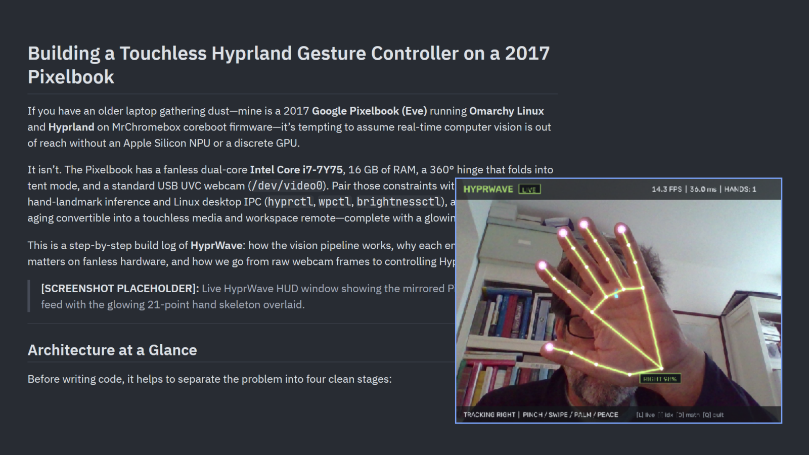

# HyprWave



A 100% local, real-time hand-gesture controller with a glowing Wayland HUD overlay for **Hyprland**—engineered to stay cool and responsive on a fanless dual-core **2017 Google Pixelbook (`i7-7Y75`, CPU-only)** running **Omarchy Linux**.

* **Case Study (cgranier.com):** *Shipping Reliable Edge AI on a 2017 Laptop* *(link to published post)*
* **Step-by-Step Build Walkthrough:** [`docs/tutorial.md`](docs/tutorial.md)

---

## Highlights & Measured Performance

| Metric | Measured on 2017 Pixelbook (`i7-7Y75`, no GPU) |
|---|---|
| **Active Tracking** | ~14–17 FPS (`36–43 ms` inference/frame via MediaPipe XNNPACK CPU) |
| **Idle Duty Cycle** | Auto-throttles `20 FPS → 4 FPS` after 2.5s (~80% less idle compute) |
| **Cloud / Privacy** | `$0` cost, 100% local on-device inference |
| **Display Stack** | Native Wayland `PyQt6` HUD (avoids OpenCV's X11-only Qt5 crash) |

---

## Quick Start

Requires Linux with a V4L2 webcam (`/dev/video0`), [`uv`](https://docs.astral.sh/uv/), and Hyprland (plus `wpctl` / `brightnessctl` for live audio/brightness controls).

```bash
git clone <your-repo-url> hyprwave
cd hyprwave

# 1. Create an isolated Python 3.12 virtualenv and install dependencies
uv sync

# 2. Download MediaPipe's Hand Landmarker model (~7.5 MB)
./scripts/fetch_model.sh

# 3. Launch in safe DEMO mode (press 'l' inside the HUD to arm LIVE control)
uv run hyprwave
```

---

## Gestures & Controls

HyprWave starts in safe **`DEMO`** mode by default (visual HUD only). Press **`l`** inside the window—or launch with `uv run hyprwave --live`—to control your desktop.

| Gesture | Action (`LIVE` Mode) | Signal / Guardrail |
|---|---|---|
| **Right-hand pinch + drag up/down** | System volume (`wpctl`) | Palm-normalized hysteresis + EMA smoothing, rate-limited |
| **Left-hand pinch + drag up/down** | Screen brightness (`brightnessctl`) | Clamped `>= 5%` so screen never blacks out |
| **Fast swipe left / right** | Next / previous Hyprland workspace | 4-knuckle centroid velocity, blur grace window, `0.70s` cooldown |
| **Open palm hold (0.6s)** | Play / pause media (`omarchy-shell`) | Edge-triggered circular progress ring |
| **Peace sign hold (0.6s)** | Toggle mute (`omarchy-audio-output-volume`) | Edge-triggered circular progress ring |

### Hotkeys & CLI Flags
* **`l`** — Toggle `DEMO` ↔ `LIVE` desktop control
* **`i`** — Overlay MediaPipe landmark indices (`0`–`20`)
* **`d`** — Toggle live gesture-math telemetry card (`PALM`, `PINCH`, `FING`, `VX`)
* **`q` / `ESC`** — Quit cleanly and release `/dev/video0`
* `--live` | `--no-tracking` | `--fps 20` | `--idle-fps 4` | `--show-indices` | `--debug-math`

---

## Hyprland Integration (Pinned PiP + Global Toggle)

Float and pin the HUD across all workspaces in `~/.config/hypr/hyprland.lua` (Omarchy Lua syntax):

```lua
o.window({ title = "^HyprWave$" }, {
  float = true,
  pin = true,
  no_dim = true,
  size = { 480, 360 },
  move = { "(monitor_w-500)", "(monitor_h-380)" },
})
```

Bind a single shortcut in `~/.config/hypr/bindings.lua` to toggle HyprWave on/off in `LIVE` mode:

```lua
o.bind("SUPER + SHIFT + H", "Toggle HyprWave gesture HUD", "/path/to/hyprwave/scripts/toggle_hyprwave.sh")
```

---

## Architecture

```
src/hyprwave/
├── config.py     # Fanless-tuned defaults (640x480 YUYV, 20 FPS active / 4 FPS idle)
├── camera.py     # V4L2 capture, low-latency buffer, pre-inference mirror, EMA FPS
├── tracker.py    # MediaPipe HandLandmarker (VIDEO mode, CPU delegate + headless EGL guard)
├── gestures.py   # Scale-invariant pinch, finger geometry, swipe velocity, hold state machines
├── hud.py        # Glowing neon skeleton, analog sliders, hold rings, swipe comet streaks, debug card
├── window.py     # Native Wayland PyQt6 HUD window with adaptive QTimer & clean SIGTERM exit
├── actions.py    # Non-blocking, rate-limited Hyprland / PipeWire / brightness / Omarchy IPC
└── main.py       # CLI entry point
```

For the full technical breakdown—including the Wayland/Qt5 fix, the LiteRT `SIGKILL` bisect, and the gesture math—see [`docs/tutorial.md`](docs/tutorial.md).

## License

MIT — see [`LICENSE`](LICENSE).
