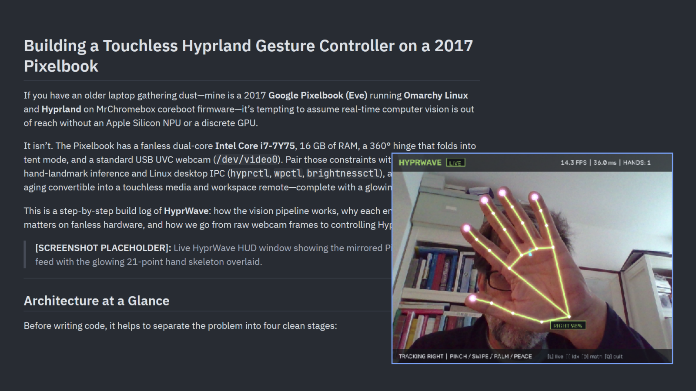
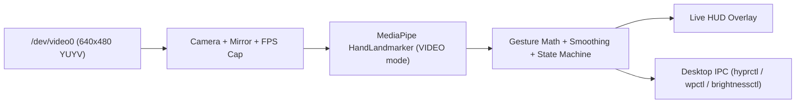

# Building a Touchless Hyprland Gesture Controller on a 2017 Pixelbook



If you have an older laptop gathering dust—mine is a 2017 **Google Pixelbook (Eve)** running **Omarchy Linux** and **Hyprland** on MrChromebox coreboot firmware—it's tempting to assume real-time computer vision is out of reach without an Apple Silicon NPU or a discrete GPU.

It isn't. The Pixelbook has a fanless dual-core **Intel Core i7-7Y75**, 16 GB of RAM, a 360° hinge that folds into tent mode, and a standard USB UVC webcam (`/dev/video0`). Pair those constraints with lightweight hand-landmark inference and Linux desktop IPC (`hyprctl`, `wpctl`, `brightnessctl`), and you can turn an aging convertible into a touchless media and workspace remote—complete with a glowing live HUD overlay.

This is a step-by-step build log of **HyprWave**: how the vision pipeline works, why each engineering decision matters on fanless hardware, and how we go from raw webcam frames to controlling Hyprland in mid-air.

---

## Architecture at a Glance

Before writing code, it helps to separate the problem into four clean stages:



Separating **capture**, **tracking**, **gesture logic**, **HUD rendering**, and **system actions** into distinct modules keeps each step easy to test—and makes it trivial to run in a safe **Demo Mode** where the HUD reacts live without scrambling your workspaces or volume.

---

## Hardware Reality Check: Designing for a Fanless 4.5W CPU

Before touching Python, inspect what your webcam actually outputs:

```bash
v4l2-ctl --device=/dev/video0 --list-formats-ext
```

On the Pixelbook (`WebCamera`), that reveals something useful right away:

| Format | Resolution | Max FPS | Why it matters |
|---|---|---|---|
| `YUYV` (uncompressed) | `640×480` | 30 fps | Zero JPEG decode overhead; crisp enough for hand landmarks |
| `YUYV` (uncompressed) | `1280×720` | 10 fps | Too slow for smooth swipe tracking |
| `MJPG` (compressed) | `1280×720` | 30 fps | 4× more pixels to resize and process for almost no tracking gain |

Three rules keep this app responsive *without* roasting a fanless chassis:

1. **Capture at `640×480` `YUYV`.** Hand-landmark models resize internally anyway—pushing 720p into OpenCV only wastes memory bandwidth and CPU heat.
2. **Pace the loop to ~15–20 FPS.** You don't need 60 FPS for workspace swipes or volume pinches. Sleeping the leftover frame budget cuts CPU usage noticeably.
3. **Use MediaPipe's `VIDEO` running mode.** In `IMAGE` mode, MediaPipe runs full-frame palm detection every frame. In `VIDEO` mode, once a hand is locked in, it tracks the bounding box frame-to-frame—much faster on a 2-core CPU.

---

## Environment Setup: Python 3.12 via `uv`

Arch/Omarchy ships bleeding-edge system Python (`3.14`), whereas MediaPipe's prebuilt wheels target Python `3.11–3.12`. Using `uv` keeps everything isolated without touching system packages:

```bash
cd hyprwave
uv sync
./scripts/fetch_model.sh
```

`fetch_model.sh` downloads Google's official `hand_landmarker.task` float16 model (~7.5 MB) into `models/`.

---

## Part 1: Camera Capture, Mirroring, and Frame Pacing (`camera.py`)

Three small details separate a janky OpenCV demo from a smooth webcam app:

* **Pin `cv2.CAP_V4L2`:** Skips OpenCV backend probing on Linux.
* **Keep `CAP_PROP_BUFFERSIZE = 1`:** Prevents stale queued frames from adding lag to gestures.
* **Mirror for natural feedback (`cv2.flip(frame, 1)`):** Moving your hand right should move the skeleton right on screen. One subtle catch we spotted immediately when testing: MediaPipe's handedness classifier assumes an *unmirrored* view (imagine someone facing you—their left hand is on your right side with the thumb pointing inward). So when you mirror the frame *before* inference, `"Left"` and `"Right"` come back swapped—and `tracker.py` flips the label back whenever `mirrored=True`.

```python
cap = cv2.VideoCapture(device_index, cv2.CAP_V4L2)
cap.set(cv2.CAP_PROP_FRAME_WIDTH, 640)
cap.set(cv2.CAP_PROP_FRAME_HEIGHT, 480)
cap.set(cv2.CAP_PROP_BUFFERSIZE, 1)
```

We also track a smoothed FPS readout using an **Exponential Moving Average (EMA)**:

```python
fps_ema = 0.85 * fps_ema + 0.15 * instant_fps
```

That same EMA trick will show up again in Part 3 when we smooth noisy finger positions into a rock-solid volume slider.

---

## Part 2: 21-Point Hand Tracking & the Live HUD (`tracker.py`, `hud.py`)

Older tutorials on the web still use `mp.solutions.hands`, which is deprecated. The modern **MediaPipe Tasks API** uses `vision.HandLandmarker` with an explicit `.task` model bundle and `RunningMode.VIDEO`.

Two gotchas to watch out for:

1. **BGR vs. RGB:** OpenCV reads frames in `BGR`, while MediaPipe expects `SRGB` (`cv2.cvtColor(frame, cv2.COLOR_BGR2RGB)`).
2. **Strictly monotonic timestamps:** `detect_for_video(mp_image, timestamp_ms)` will throw an error if two frames ever share the same millisecond timestamp. Guarding `now_ms = max(int(time.monotonic() * 1000), last_ms + 1)` eliminates that bug permanently.

Each detected hand gives you **21 normalized 3D landmarks** (`x` and `y` from `0.0` to `1.0`, plus relative depth `z`):

* `0`: Wrist
* `4`: Thumb tip
* `8`: Index fingertip
* `12`: Middle fingertip
* `16`: Ring fingertip
* `20`: Pinky fingertip

### Making the Overlay Look Good — And a Real Wayland Gotcha
Instead of flat 1-pixel green lines, `hud.py` draws the hand skeleton onto a separate black buffer with thick lines, applies a light `cv2.GaussianBlur`, and blends it back with `cv2.addWeighted`. That gives a clean neon glow for just a millisecond or two of extra CPU time.

There's also a classic Linux/Wayland trap we hit immediately on Omarchy: PyPI's `opencv-python` / `opencv-contrib-python` wheels bundle Qt5 with **only** the X11 (`xcb`) platform plugin—no Wayland plugin. On a pure-Wayland Hyprland session (where `DISPLAY` isn't set), `cv2.imshow()` immediately aborts with:

```text
qt.qpa.plugin: Could not find the Qt platform plugin "wayland"
Available platform plugins are: xcb.
```

Worse, importing `cv2` silently sets `QT_QPA_PLATFORM_PLUGIN_PATH` to OpenCV's bundled Qt5 folder, which breaks Qt6 apps too! The clean fix (in `window.py`) is to render the HUD in a native **PyQt6** window (which ships real Qt6 Wayland support and handles the Pixelbook's 2400×1600 HiDPI scaling cleanly) and strip OpenCV's `QT_QPA_*` overrides right before creating `QApplication`.

There was a second subtle Linux/Hyprland gotcha with **MediaPipe 1.2+'s LiteRT runtime**: even when you explicitly request `Delegate.CPU`, LiteRT probes Wayland/X11 EGL displays during `HandLandmarker.create_from_options()`, which silently got terminated (`SIGKILL` / exit `137`) on Intel HD 615 right after `XNNPACK CPU accelerator registered.` Temporarily hiding `DISPLAY`, `WAYLAND_DISPLAY`, `XDG_RUNTIME_DIR`, and `DBUS_SESSION_BUS_ADDRESS` inside a tiny context manager during `create_from_options()` keeps LiteRT cleanly on XNNPACK CPU—and immediately restores those variables so PyQt6 opens natively on Wayland.

Run it now and press **`i`** to see all 21 landmark numbers live on your own hand:

```bash
uv run hyprwave --show-indices
```

On my fanless 2017 Pixelbook (`i7-7Y75`), that immediately hit **~17 FPS** with hands in frame (~43 ms inference per frame) and a steady **20 FPS** (our cap) when idle—plenty smooth for real-time gesture control without a discrete GPU.

> **[SCREENSHOT PLACEHOLDER]:** Close-up of the HUD with `--show-indices` enabled, showing landmark numbers `0`–`20` on the hand.

---

## Part 3: Gesture Math, Smoothing & State Machines (`gestures.py`)

Getting 21 landmarks onto the screen is the flashy part. Making gestures feel *reliable*—no jitter, no accidental triggers when you scratch your nose, and consistent whether you're sitting close or across the desk—is where real signal processing comes in.

### 1. Scale Invariance & Aspect-Ratio Correction
A classic first mistake is writing `if distance(thumb_tip, index_tip) < 40 pixels: pinch()`. Move two feet back from the laptop and your hand shrinks in half, breaking every threshold.

Two tiny lines fix it:
1. Multiply `dx` by the frame's aspect ratio (`640 / 480 = 1.333`) so horizontal and vertical distances share the same scale in MediaPipe's `[0, 1]` coordinates.
2. Divide every distance by your **palm length** (`distance(wrist #0, middle MCP #9)`).

Now `pinch_ratio = dist(thumb #4, index #8) / palm_size` means the exact same thing at 1 foot or 4 feet.

### 2. Hysteresis (Stopping Pinch Flicker)
With a single threshold (say `0.40`), holding your fingers near the boundary causes rapid `on/off/on/off` chatter. Borrowing a trick from hardware engineering (a **Schmitt trigger**), we use two thresholds:
* **Enter pinch:** `pinch_ratio < 0.36`
* **Exit pinch:** `pinch_ratio > 0.52`

Once pinched, we anchor the starting Y position and current value, smooth the live Y coordinate with an **Exponential Moving Average (`alpha = 0.35`)**, and map vertical movement (`±38%` of frame height) to `0–100%`. Right-hand pinch controls **Volume**; left-hand pinch controls **Brightness**.

### 3. Rotation-Tolerant Finger Extension
Instead of checking `tip.y < knuckle.y` (which breaks the instant you tilt your hand), we compare each fingertip's distance from the wrist (`#0`) against its middle knuckle (PIP joint, e.g., `#8` vs `#6` for index):

```python
extended = dist2d(wrist, tip, aspect) > dist2d(wrist, pip, aspect) * 1.15
```

That works at almost any hand angle and cleanly separates an **Open Palm** (all 4 fingers extended) from a **Peace Sign** (index + middle up, ring + pinky curled).

### 4. Preventing Misfires: Velocity Windows, Cooldowns & Hold Rings
* **Swipes (Left / Right):** Our first naive swipe detector failed in live testing at 17 FPS for two instructive reasons: fast hand swipes occasionally cause 1–2 frames of webcam motion blur (which wiped our history buffer when `hands` came back empty), and comparing only against the *oldest* point in a short window penalized swipes starting from rest. Switching to track the **palm center (`#9`)**, adding a `0.18s` motion-blur grace window, and scanning all recent segments in a `0.40s` rolling buffer (`|dx| >= 16%`, speed `>= 0.55` widths/sec, `|dx| >= 1.4 * |dy|` to allow a natural forearm arc) made swipes feel immediate while a `0.75s` cooldown still prevents reverse-swipe double triggers.
* **Hold-to-Trigger Poses (Open Palm & Peace Sign):** Both require holding steady (`|vx| < 0.45`) for `0.60s` while a glowing circular arc fills around your palm. Once fired, the pose locks until you release it, preventing repeat toggles.

Press **`d`** while running HyprWave to pop open the live gesture-math telemetry card (`PALM`, `PINCH`, `FING`, `VX`) and watch the numbers react in real time:

```bash
uv run hyprwave --debug-math
```

> **[SCREENSHOT PLACEHOLDER]:** Live HUD showing the right-hand Volume pinch slider, glowing skeleton, and the `[D]` gesture-math telemetry box in the bottom-left corner.

---

## Part 4: Driving Hyprland, PipeWire & Omarchy Safely (`actions.py`)

With all five gestures feeling reliable in Demo Mode—and a persisted glowing swipe comet streak + high-contrast confirmation banner so every trigger is visually unmistakable—wiring them up to the real Linux desktop takes less than 100 lines of Python.

| Gesture | Desktop Command | Why this command |
|---|---|---|
| **Swipe Left / Right** | `hyprctl dispatch 'hl.dsp.focus({ workspace = "r+1" })'` / `"r-1"` | Uses Omarchy's Lua Hyprland dispatcher to step across workspaces (even if only one is open) |
| **Right-Hand Pinch** | `wpctl set-volume @DEFAULT_AUDIO_SINK@ <0.00..1.00>` | Fast direct PipeWire control, synced from current volume at startup |
| **Left-Hand Pinch** | `brightnessctl -d intel_backlight set <5..100>%` | Clamped to `>= 5%` so a downward pinch never blacks out the screen |
| **Open Palm Hold** | `omarchy-shell -q media playPause` | Hits Omarchy Shell's local UNIX socket directly (~5 ms) |
| **Peace Sign Hold** | `omarchy-audio-output-volume mute-toggle` | Respects DSP sinks and triggers Omarchy's native mute OSD |

Three practical guardrails keep desktop control smooth:

1. **Non-blocking `subprocess.Popen`:** Never call blocking `subprocess.run()` inside a 17–20 FPS render loop—spawning asynchronously (and reaping finished processes) keeps the HUD fluid while commands execute in the background.
2. **Rate-limiting analog sliders:** Pinch-and-drag only fires an IPC update every `80 ms` and only when the percentage moves by at least `2%`, avoiding PipeWire/sysfs spam.
3. **One-key `DEMO` ↔ `LIVE` toggle (`[L]`):** HyprWave boots into safe **DEMO** mode by default (or pass `--live`). Press **`l`** anytime to turn desktop control on or off mid-demo.
4. **Pin the HUD across workspaces (`~/.config/hypr/hyprland.lua`):** Otherwise the moment you swipe to Workspace 2, your HUD stays behind on Workspace 1! Adding a 7-line Omarchy window rule floats HyprWave as a crisp corner PiP that travels with you across every workspace:

```lua
o.window({ title = "^HyprWave$" }, {
  float = true,
  pin = true,
  no_dim = true,
  size = { 480, 360 },
  move = { "(monitor_w-500)", "(monitor_h-380)" },
})
```

> **[SCREENSHOT PLACEHOLDER]:** HyprWave in `LIVE` mode (green badge) floating pinned in the bottom-right corner mid-swipe with the glowing directional comet streak and confirmation banner.

---

## Part 5: Running Cool in Tent Mode & One-Shortcut Launch

A gesture controller you have to launch from a terminal—or that cooks your lap while waiting for a wave—won't actually get used. Two final touches turn HyprWave from a weekend demo into a real daily utility on a fanless Pixelbook.

### 1. Adaptive Idle FPS (`20 FPS` Active → `4 FPS` Idle)
When no hand has been visible for `2.5` seconds, HyprWave automatically drops its Qt render timer from **20 FPS** (`50 ms` interval) down to **4 FPS** (`250 ms` interval) and lights up an amber **`IDLE`** pill in the HUD header. That cuts idle inference work by **~80%** while still waking up inside a quarter-second the moment you raise a hand—snapping instantly back to 20 FPS.

```python
next_interval = _fps_to_ms(desired_fps)
if next_interval != self._current_interval_ms:
    self._current_interval_ms = next_interval
    self._timer.setInterval(next_interval)
```

### 2. One-Key Global Toggle (`Super + Shift + H`)
Because HyprWave traps both `SIGINT` and `SIGTERM` to close the Qt event loop cleanly (releasing `/dev/video0` and turning off the webcam LED immediately), toggling it from anywhere on the desktop is a 25-line bash script (`scripts/toggle_hyprwave.sh`) wired into `~/.config/hypr/bindings.lua`:

```lua
o.bind(
  "SUPER + SHIFT + H",
  "Toggle HyprWave gesture HUD",
  "/path/to/hyprwave/scripts/toggle_hyprwave.sh"
)
```

Press `Super + Shift + H`: the glowing HUD floats into the bottom-right corner in `LIVE` mode, pinned across every workspace. Press `Super + Shift + H` again: it shuts down cleanly and turns the camera off.

---

## What I Learned Building This on a 9-Year-Old Fanless Laptop

1. **You don't need a GPU for fun, real-time CV.** At `640×480` YUYV and 15–20 FPS with MediaPipe's `VIDEO` tracking mode, a 2017 4.5W dual-core Intel chip handles 21-point hand tracking at ~17 FPS (~43 ms/frame) without breaking a sweat.
2. **Real CV is mostly signal processing, not model calls.** The difference between a toy demo and something you'll actually use comes down to scale invariance, hysteresis, EMA smoothing, motion-blur grace frames, and cooldowns.
3. **Linux/Wayland plumbing matters.** Knowing why PyPI OpenCV's bundled Qt5 aborts on pure Wayland—and why MediaPipe's LiteRT EGL probe needs a headless env context on Intel HD 615—saves hours of head-scratching.

### Where to Take It Next
* **Custom gesture recorder:** Capture 30 samples of your own hand poses (normalized by palm size) and train a tiny KNN or linear classifier on top of the 21 landmarks.
* **Headless tent-mode flag:** Add `--headless` so you can run the gesture loop with zero window rendering when watching a movie across the room.
* **Per-app actions:** Read the active Hyprland window class (`hyprctl activewindow -j`) so swipes change browser tabs in Chromium, slides in a presentation, or workspaces everywhere else.
